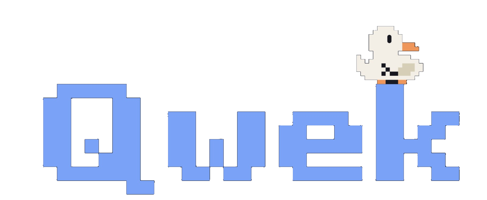

<p align="center">
  
</p>

# Qwek

A realtime chat client for the terminal, built with .NET 10 and Spectre.Console.

Qwek connects to the backend over HTTP and SignalR. It is designed for
keyboard-driven use on Windows and Linux, with a full-screen TUI, avatars, markdown,
attachments, profiles, unread tracking, and live social features.

## Features

- Server and channel navigation
- Realtime messaging over SignalR
- Markdown rendering: bold, italic, inline code, fenced code blocks, and links
- File attachments and inline image previews
- Message search with fuzzy matching
- Message editing and deletion
- Replies, emoji reactions, typing indicators, and presence
- Per-channel unread counts and `@mention` badges across all servers
- Member autocomplete when typing `@` in the composer
- Quick switcher for servers and channels
- Account profiles with saved sessions
- User profiles with display name, username, and avatar upload
- Multiline composer, session-only per-channel drafts, emoji picker, and clipboard image paste
- Windows and Linux release packages with install scripts

## Requirements

- Windows 10+ or Linux
- An interactive terminal of at least 64x18
- A running Qwek backend
- For source builds: the .NET 10 SDK
- For clipboard image paste on Linux: `wl-paste` (Wayland) or `xclip` (X11)
- A terminal with Unicode and emoji support is recommended
- Clickable links require a terminal with OSC 8 hyperlink support

## Install

### Windows

```powershell
Invoke-WebRequest -Uri https://raw.githubusercontent.com/MeiSastraJayadi/qwek-tui/master/install.ps1 -OutFile install.ps1
powershell -ExecutionPolicy Bypass -File .\install.ps1
```

By default the installer places `qwek.exe` in `%LOCALAPPDATA%\Programs\Qwek`
and adds that directory to your user `PATH`.

Options:

```text
-Version <tag>     Install a specific release
-InstallDir <dir>  Choose the install directory
-FromSource        Build with the .NET 10 SDK
-Uninstall         Remove the installed app and PATH entry
-NoPath            Do not modify PATH
```

If no release is available, the installer falls back to building from source
when the .NET 10 SDK is installed.

### Linux

```bash
curl -fsSL https://raw.githubusercontent.com/MeiSastraJayadi/qwek-tui/master/install.sh | bash
```

The installer uses `/usr/local` when its `bin` directory is writable and
`~/.local` otherwise.

Options:

```text
--version <tag>    Install a specific release
--prefix <dir>     Choose the install prefix
--from-source      Build with the .NET 10 SDK
--uninstall        Remove the installed binary
```

### From source

```bash
git clone https://github.com/MeiSastraJayadi/qwek-tui.git
cd qwek-tui
dotnet run
```

## Run

```text
qwek [options]
```

| Option | Description |
| --- | --- |
| `-u, --url <url>` | Backend base URL |
| `-p, --profile <name>` | Use or create a saved account profile |
| `--logout` | Forget a saved account profile |
| `-h, --help`, `help` | Show CLI help |

Environment variables:

| Variable | Description |
| --- | --- |
| `QWEK_URL` | Backend base URL |
| `QWEK_PROFILES_DIR` | Override the profile storage directory |
| `QWEK_CONFIG_DIR` | Override the configuration directory |

Examples:

```bash
qwek --profile alice
qwek --profile bob
qwek --url https://chat.example.com
qwek --logout --profile alice
qwek --logout
```

### Saved accounts

Sessions are stored as separate JSON profiles:

- Windows: `%APPDATA%\Qwek\profiles\alice.json`
- Linux: `$XDG_CONFIG_HOME/qwek/profiles/alice.json`,
  normally `~/.config/qwek/profiles/alice.json`

Each profile is tied to its backend URL and user ID. If multiple profiles exist
for the current backend, Qwek shows an account picker at startup. Profiles store
the access token in plain JSON; on Linux the files and directory are restricted to
the current user.

## Configuration

Optional configuration lives at:

- Windows: `%APPDATA%\Qwek\config.json`
- Linux: `~/.config/qwek/config.json`

Choose whether `Enter` or `Ctrl+Enter` sends a message:

```json
{
  "sendKey": "enter"
}
```

```json
{
  "sendKey": "ctrl+enter"
}
```

With `"enter"`, `Enter` sends and `Shift+Enter` inserts a newline.
With `"ctrl+enter"`, `Ctrl+Enter` sends and `Enter` inserts a newline.
`Ctrl+J` always inserts a newline.

## Keybindings

Press `?` or `F1` inside the app for the scrollable help overlay. Use `↑↓`,
`PgUp`/`PgDn`, and `Home`/`End` to scroll it.

### Navigation

| Key | Action |
| --- | --- |
| `Tab` / `Shift+Tab` | Move focus between panes |
| `Left` / `Right` | Move focus |
| `Up` / `Down` | Move selection |
| `PgUp` / `PgDn` | Scroll messages |
| `Home` | Jump to the oldest visible position |
| `End` | Jump to the latest message |
| `Enter` | Open the focused item or start typing |

### Messaging

| Key | Action |
| --- | --- |
| `i` | Start typing |
| `/` | Search messages in the current channel |
| `@` | Open member autocomplete; type to filter, `↑↓` select, `Tab`/`Enter` insert |
| `Enter` | Send (default) or newline depending on `sendKey` |
| `Shift+Enter` / `Ctrl+J` | Insert a newline |
| `Esc` | Cancel a reply, leave the composer, or close an overlay |
| `↑` / `↓` | Browse sent-message history while typing |
| `e` | Edit the selected message |
| `d` | Delete the selected message |
| `f` | Send a file |
| `o` | Open the selected attachment |
| `F4` | Paste and send a clipboard image |
| `F5` | Refresh servers, channels, and messages |

### Social features

| Key | Action |
| --- | --- |
| `r` | Reply to the selected message (message pane) |
| `r` | Refresh from other panes |
| `x` | Add or remove a reaction on the selected message |
| `u` | Jump to the next unread channel, across servers |

### Servers and channels

| Key | Action |
| --- | --- |
| `n` | Create a server |
| `c` | Create a channel |
| `j` | Join a server by GUID |
| `v` | Show server details and member presence |
| `p` | Open your profile |
| `Ctrl+K` / `F2` | Quick switcher |
| `Ctrl+E` / `F3` | Emoji picker |
| `?` / `F1` | Toggle help |
| `q` / `Ctrl+C` | Quit |

In the profile view: `d` edits the display name, `u` edits the username,
`a` opens the avatar picker, and `x` removes the avatar.

## Commands

Type these in the message box and press `Enter`:

| Command | Action |
| --- | --- |
| `/help` or `/keys` | Open the help overlay |
| `/refresh` | Refresh all data |
| `/quit` or `/exit` | Quit |
| `//text` | Send a message that begins with `/` |

Unknown commands are rejected and the input is kept for editing.

## Markdown

| Syntax | Result |
| --- | --- |
| `**bold**` or `__bold__` | Bold |
| `*italic*` or `_italic_` | Italic |
| `` `code` `` | Inline code |
| Triple-backtick fenced blocks | Code block with gutter and wrapping |
| `[label](https://example.com)` | Clickable link |
| `https://example.com` | Automatically linked URL |

Message text is escaped before rendering, and unsupported or malformed markup is
shown as plain text.

## Clipboard images

`F4` reads an image from the system clipboard and sends it as an attachment.
On Windows this uses PowerShell and `System.Windows.Forms.Clipboard`, and also
supports copied image files. On Linux it uses `wl-paste` or `xclip`.

## Backend

Qwek expects a backend with:

- JWT authentication
- REST endpoints under `/api`
- SignalR hub at `/hubs/chat`
- Server/channel membership checks
- PostgreSQL via Entity Framework Core

Replies, reactions, typing, and presence require the backend schema and hub
changes included in the matching backend release, including the social-features
migration. Apply pending migrations before starting the updated backend:

```bash
dotnet ef database update
```

Run that command from the backend project directory.

## Development

Build the project:

```bash
dotnet build Qwek.csproj
```

Run with a local backend:

```bash
dotnet run -- --url http://localhost:5206
```

Run from a published binary:

```bash
dotnet publish Qwek.csproj -c Release -r <runtime-id> --self-contained true -p:PublishSingleFile=true
```

Supported runtime identifiers are `win-x64`, `win-arm64`, `linux-x64`, and
`linux-arm64`.

### Release packages

Create self-contained packages for Windows and Linux:

```bash
./scripts/build-release.sh
```

```powershell
.\scripts\build-release.ps1
```

The scripts produce `win-x64`, `win-arm64`, `linux-x64`, and `linux-arm64`
packages in `dist/`, with a SHA-256 checksum file. Release builds receive the
default backend URL from the `QWEK_DEFAULT_BACKEND_URL` GitHub Actions repository
variable, which must be set before pushing a release tag. Pushing a tag like
`v1.0.0` runs `.github/workflows/release.yml`, builds the packages, and publishes
a GitHub release that the install scripts consume.

## Project structure

```text
Api/        HTTP client and DTOs
Auth/       Login flow, profiles, and session storage
Config/     Local configuration
Tui/        TUI state, rendering, markdown, avatars, and clipboard support
scripts/    Release packaging
install.sh  Linux installer
install.ps1 Windows installer
```

## Contributing

See [CONTRIBUTING.md](CONTRIBUTING.md) for development setup, testing, and pull
request guidelines.

## License

Released under the [MIT License](LICENSE).

